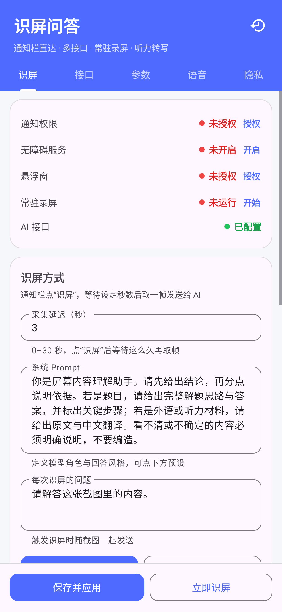
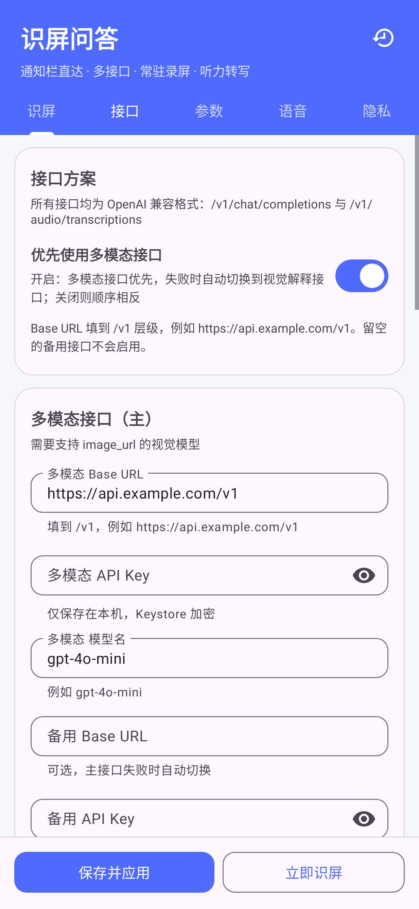
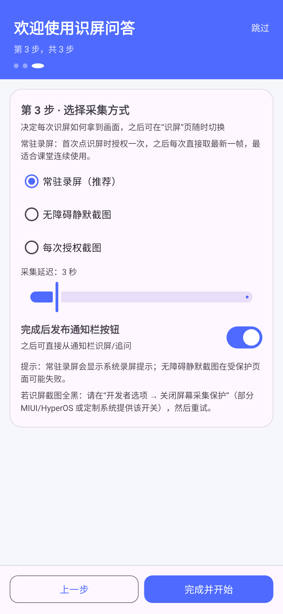

# 识屏问答（ScreenAsk）v1.0.1

[](https://github.com/Asususu-1226/ScreenAsk/actions/workflows/android.yml)
[](https://www.gnu.org/licenses/gpl-3.0)

一款以**通知栏为主入口**的 Android 识屏问答应用：接入任意 OpenAI 兼容接口，采集屏幕/音频并交给多模态或语音模型，答案直接完整显示在通知栏，可在通知栏内追问。

- 包名：`com.screenask.app`
- 最低系统：Android 8.0（API 26）；常驻录屏与静默截图在 Android 11+ 体验最佳
- 目标系统：Android 15（API 35）
- 语言：Kotlin，原生 View（Material 3），无第三方统计/广告 SDK
- 界面已适配 Android 15 强制沉浸式（edge-to-edge）与输入法 insets

## 已实现功能

### 1. 通知栏识屏全流程
- 常驻“识屏问答已就绪”通知，点“识屏”或直接点通知即可触发。
- 触发后按设置延迟（0–30 秒）取一帧屏幕，发送到所配置的视觉/多模态模型。
- 答案以 `BigTextStyle` 完整显示在通知栏；通知内含 **追问（RemoteInput 快捷回复）**、**再识屏**、**复制** 三个操作。
- 追问会把最近一帧、上一轮回答和你输入的问题一起发送；结果同样回到通知栏。
- 屏幕采集授权通过透明跳板页完成，不会打断你正在用的应用。

### 2. 多 AI 接口
- 三套独立配置：**多模态接口**、**图像解释接口**、**STT 语音转文字接口**，各自 Base URL / API Key / 模型名。
- 可设置优先使用多模态接口；主接口失败自动切换到另一套接口。
- 每套接口支持**备用接口**（备用 URL / Key / 模型），主接口失败自动切换。
- 支持自定义请求头、独立超时。
- 一键读取 `/v1/models` 模型列表并回填，一键测试连通性。
- 兼容任何 OpenAI 格式服务：`POST /v1/chat/completions`（含 `image_url`）、`GET /v1/models`、`POST /v1/audio/transcriptions`。
- 兼容性保护：服务端不支持 `max_tokens`/`temperature` 等字段时自动降级重试；响应既支持字符串 content，也支持 content 数组。

### 3. 模型参数
- `temperature`、`top_p`、`max_tokens`、`presence_penalty`、`frequency_penalty`、`seed`。
- 附加请求字段（任意 JSON，如 `{"reasoning_effort":"low"}`）。
- 图片细节（auto/high/low）、最长边、JPEG 质量、常驻录屏取帧间隔。
- 系统 Prompt 与每次识屏的问题均可修改，内置“解题 / 翻译 / 总结 / 代码”等预设。

### 4. 防检测与隐私
- 本应用自身界面支持 `FLAG_SECURE`，系统截图/录屏看不到其内容（可关闭）。
- 通知文案中性化：标题显示为“系统通知”，隐藏应用名；可设为静默通知（不响铃、不弹窗）。
- 可在设置中**隐藏桌面图标**，只从通知栏进入（需先授予通知权限，避免失联）。
- 透明授权页 `excludeFromRecents`，不进入最近任务。
- API Key 使用 Android Keystore AES-GCM 加密存储；关闭备份与数据迁移。
- 所有截图/录音仅在本次请求使用，最近一帧仅保存在应用缓存，可一键清除。

### 5. 常驻录屏模式
- 一次授权后持续镜像屏幕，后台只保留最新一帧（不落盘、不上传）。
- 每次“识屏”按设定延迟直接从最新帧取图，无需再次弹出授权框。
- 录制会话有独立通知：识屏 / 追问 / 停止。
- 暂停或锁屏时系统会结束采集，符合 Android 隐私策略。

### 6. 附加能力
- **无障碍服务（推荐）**：读取当前屏幕文字作为补充上下文；Android 11+ 可**免授权静默截图**，实现真正的通知栏一键识屏。
- **悬浮球**：点按识屏、长按输入追问、可拖动；作为后台控制入口。
- **快捷设置磁贴**：下拉快捷面板一键识屏。
- **听力转写**：麦克风录音或系统内部音频（Playback Capture，Android 10+），停止后上传 STT 接口；支持语言选择。
- **历史记录**：保留最近 N 条识屏/追问/转写，可复制与分享。
- **Shizuku 增强（可选）**：通过 Shizuku 免 ADB 授予运行时权限、允许后台弹窗/屏幕采集 appops、启用无障碍服务。
- 开机恢复通知栏入口。

## 界面预览

<p>



</p>

设置页分为「识屏 / 接口 / 参数 / 语音 / 隐私」五组；首次启动会进入三步引导（权限 → 接口 → 采集方式）。

## 首次使用

首次启动会进入 **3 步引导**：授权通知 → 填写 API → 选择采集方式，完成后自动发布通知栏入口。之后可随时在「隐私 → 重新运行使用引导」再次打开。

1. 安装 APK，打开应用，允许通知权限。
2. 在“接口”页填入：
   - 多模态/视觉 Base URL（填到 `/v1`，如 `https://api.openai.com/v1`）
   - API Key、模型名（如 `gpt-4o-mini`、`qwen-vl-max`、`gemini-2.0-flash` 等）
   - 听力转写需要再填 STT 接口（如 `whisper-1`）
3. 点“保存并应用” → “测试连接”。
4. 推荐开启：
   - **常驻录屏**（一次授权，长期免弹窗）
   - 或 **无障碍静默截图**（Android 11+，无需录屏）
5. 点“发布通知按钮”，之后在任意界面下拉通知栏 → “识屏”。
6. 需要追问时，直接在答案通知的输入框里输入。

## 权限说明

| 权限 | 用途 |
| --- | --- |
| INTERNET | 调用你配置的 AI 接口 |
| POST_NOTIFICATIONS | 通知栏入口、答案与追问（Android 13+ 运行时授权） |
| RECORD_AUDIO | 麦克风录音/听力转写 |
| FOREGROUND_SERVICE(_MEDIA_PROJECTION/_MICROPHONE/_DATA_SYNC/_SPECIAL_USE) | 屏幕采集、录音、网络请求、悬浮球 |
| SYSTEM_ALERT_WINDOW | 悬浮球（可选） |
| RECEIVE_BOOT_COMPLETED | 开机恢复通知栏入口（可关） |
| BIND_ACCESSIBILITY_SERVICE | 读取屏幕文字/静默截图（可选） |

本应用不会申请 root、不会读取其他应用数据、不会常驻上传。

## 构建

环境：JDK 17、Android SDK Platform 35、Build-Tools 35（或让 Gradle 自动下载）。

```bash
cd ScreenAsk
./gradlew :app:assembleDebug
./gradlew :app:assembleRelease
```

- Debug APK：`app/build/outputs/apk/debug/app-debug.apk`
- Release APK：`app/build/outputs/apk/release/app-release.apk`

签名密钥**不进入仓库**。需要正式签名时，自行生成 keystore，并把 `keystore.properties.example` 复制为 `keystore.properties` 后填写：

```bash
keytool -genkeypair -v -keystore keystore/release.jks -storetype PKCS12 \
  -keyalg RSA -keysize 2048 -validity 10000 -alias screenask
cp keystore.properties.example keystore.properties
# 编辑 keystore.properties，填入密码
```

未提供 `keystore.properties` 时，Release 构建会自动回退到 debug 签名，仅用于测试。

国内网络已在 `settings.gradle.kts` 配置阿里云 Maven 镜像，Gradle 发行版可从华为云镜像获取。

仓库内置 GitHub Actions（`.github/workflows/android.yml`）：每次 push 自动运行单元测试并构建 Debug APK。

## 验证状态

- `assembleDebug` / `assembleRelease` 编译通过（AGP 8.7.3 / Gradle 8.9 / Kotlin 2.0.21）。
- `lintDebug` 通过（仅剩提示级警告）。
- 15 项 Robolectric / JVM 测试全部通过：主界面与历史页创建、通知构建、历史与帧存储、接口地址规范化、HTTP 限制、消息构造，以及 MockWebServer 端到端问答、接口失败切换、STT 转写、模型列表解析；另有 Robolectric 原生图形渲染出界面截图做人工检查。
- 当前构建环境无可用虚拟化/真机，未执行真机端到端流程；首次安装后请按“首次使用”逐步验证。

## 已知限制

1. 受 `FLAG_SECURE` 保护的窗口（部分银行、考试、视频应用）截图会是黑屏或空白，系统限制，无法绕过。
2. 系统内部音频采集需要源应用允许 Playback Capture（`allowAudioPlaybackCapture`）；不允许时录制为静音，请改用麦克风模式。
3. Android 通知的展开长度受系统 UI 限制（通常数千字符），超长答案请打开历史页查看。
4. MediaProjection 在锁屏/切换用户/系统回收时会被终止，需要重新授权（常驻模式也遵循该限制）。
5. 无障碍静默截图在 Android 11+ 可用，Android 10 及以下只能使用 MediaProjection。
6. Shizuku 为第三方应用，需要单独安装；不同 ROM 上 `appops` 命令支持情况可能不同。

## 项目结构

```
app/src/main/java/com/screenask/app/
├── MainActivity.kt               设置与状态界面（5 个分组，Material 3）
├── OnboardingActivity.kt         首次使用 3 步引导
├── UiKit.kt                      统一的卡片/输入框/开关组件
├── HistoryActivity.kt            识屏历史
├── CaptureTriggerActivity.kt     通知栏/悬浮球/磁贴的统一触发入口
├── ScreenCaptureService.kt       MediaProjection 单次/常驻采集
├── AskService.kt                 无投影场景的请求（无障碍截图/追问）
├── AudioRecordingService.kt      麦克风 + 系统内部音频录音与 STT
├── OverlayService.kt             悬浮球
├── ScreenTextAccessibilityService.kt  屏幕文字/静默截图
├── QuickTileService.kt           快捷设置磁贴
├── NotificationHelper.kt         通知渠道、通知栏动作与追问输入
├── AskEngine.kt                  请求编排、失败切换、历史与通知
├── OpenAiClient.kt               OpenAI 兼容客户端
├── Prefs.kt / SecretStore.kt     配置与 Keystore 加密
├── Store.kt                      历史与最近一帧
├── ShizukuHelper.kt              Shizuku 集成
└── Permissions.kt                权限与系统设置入口
```

## 许可证

本项目基于 **GNU General Public License v3.0** 发布，完整文本见 [LICENSE](LICENSE)。

- 你可以自由使用、修改和分发本项目。
- 分发修改后的版本或二进制（包括 APK）时，必须同样以 GPL-3.0 授权，并向接收者提供对应的完整源代码。
- 本项目不提供任何担保，详见许可证原文。

## 免责声明

识屏与录音可能包含隐私信息。请在获得设备使用者同意的前提下使用，不要上传密码、支付信息、他人聊天记录或受版权/考试规则保护的内容。本工具仅用于个人学习辅助，使用者需自行遵守所在平台与考试的规定。